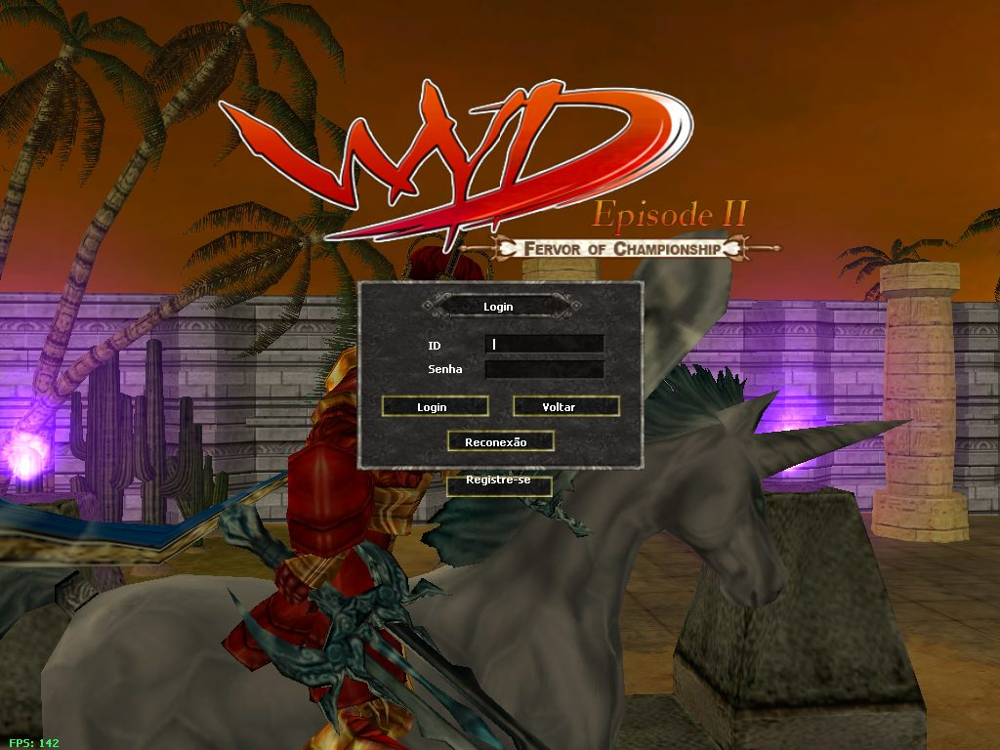
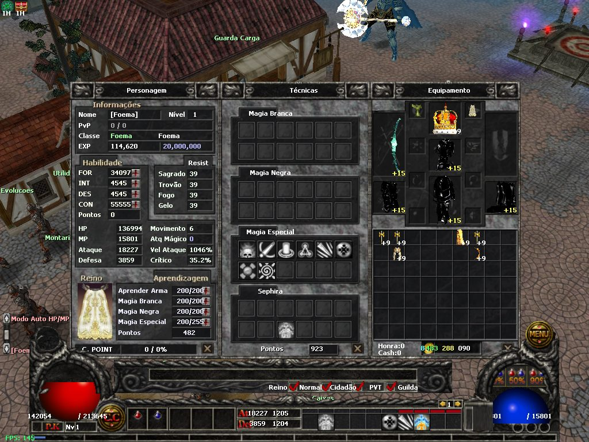
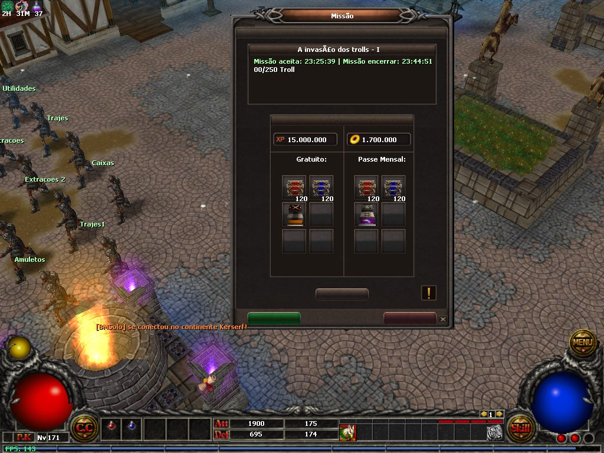
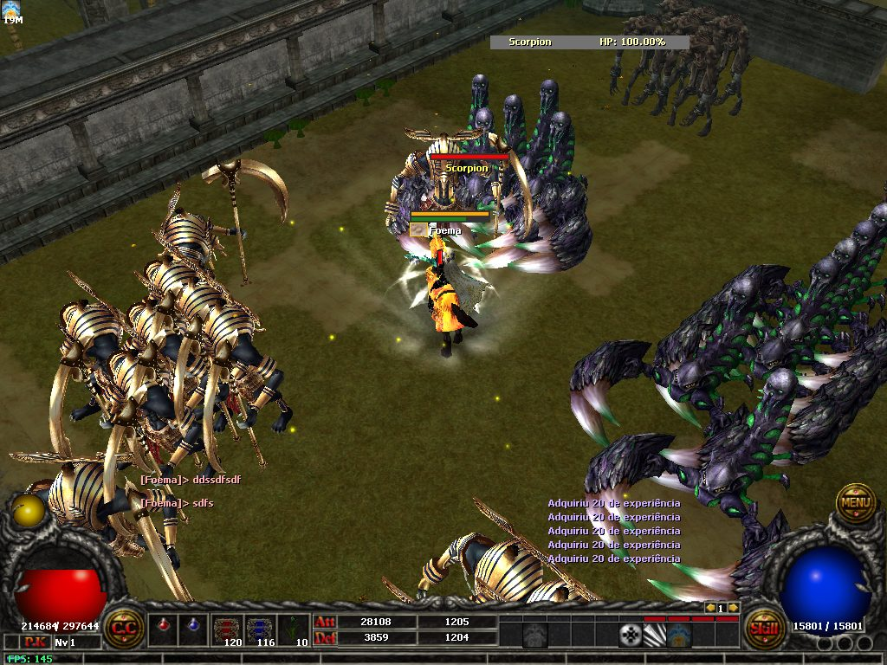
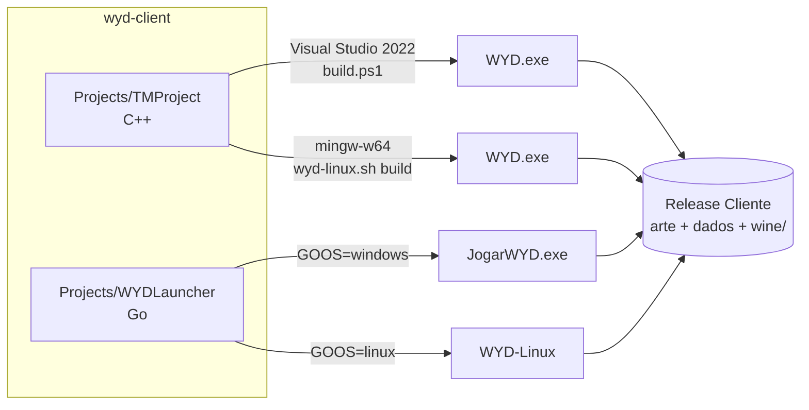
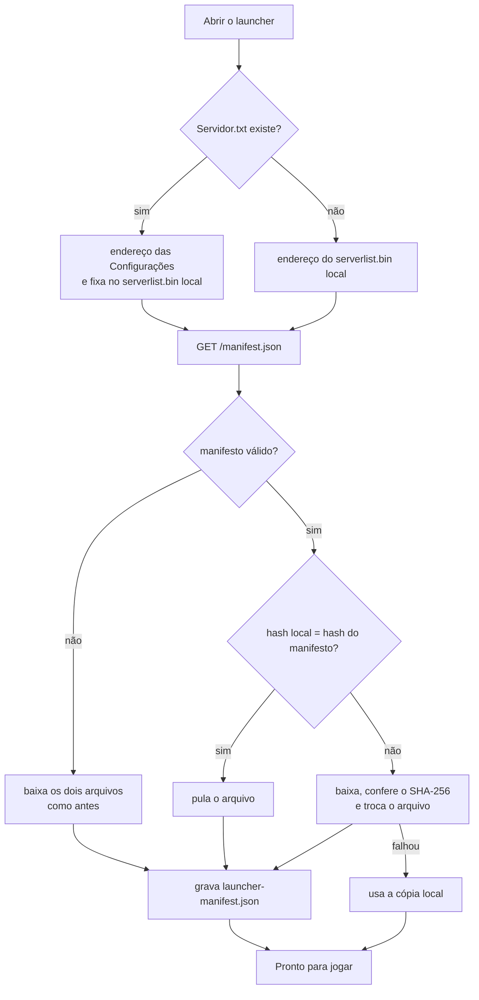

# Cliente WYD 7.87 x64

Cliente de With Your Destiny baseado na descompilação do TMProject, levado
para 64 bits, com build para Windows e Linux, launcher próprio em Go e a
interface do 7.543 sobre os arquivos do 7.87. Funciona com o servidor do
repositório `wyd-go-server`.

| | |
|---|---|
|  |  |
| Abertura do 7.543: logo, painel de servidores e caixa de login | Atributos, HP e gold em 64 bits |
|  |  |
| Janela de missão | HUD 7.543 em combate |

- [O que tem neste repositório](#o-que-tem-neste-repositório)
- [O que foi criado e modificado](#o-que-foi-criado-e-modificado)
- [Decisões técnicas](#decisões-técnicas)
- [Compilação](#compilação)
- [Release](#release)
- [Launcher](#launcher)
- [Regras para código novo](#regras-para-código-novo)
- [Origem e licença](#origem-e-licença)

## O que tem neste repositório

| Pasta | Conteúdo |
|---|---|
| `Projects/TMProject` | O cliente (C++, Direct3D 9). Gera o `WYD.exe`. |
| `Projects/WYDLauncher` | O launcher (Go, sem dependências). Gera `JogarWYD.exe` (Windows) e `WYD-Linux`. |
| `CommonFiles` | Structs compartilhadas. |
| `Dependencies/D3DX` | D3DX 43 (headers, lib x64 e DLLs), do pacote oficial `Microsoft.DXSDK.D3DX` 9.29.952.8. |
| `Dependencies/monocypher` | Monocypher 4.0.2 (BSD-2-Clause ou CC0), sem alterações: a criptografia do transporte. |
| `Dependencies/Directx/Include` | Headers do DirectX SDK usados pelo build do Visual Studio (DirectShow, DirectSound, DirectInput). |
| `build.ps1`, `TM.sln` | Build do Windows. |
| `wyd-linux.sh`, `CMakeLists.txt`, `cmake/` | Build do Linux (mingw-w64 + Wine). |

Os arquivos de arte e dados do jogo não ficam aqui: estão na pasta do jogo,
`../wyd-others/Release Cliente` por padrão.



## O que foi criado e modificado

### 64 bits

- O cliente é **só x64**. As configurações Win32 saíram do projeto.
- Gold, experiência, dano, HP, MP, ataque, defesa e atributos são
  `long long`; o efeito de item tem 16 bits, e o item foi de 8 para 14 bytes.
  A lista de structs e pacotes alterados está em
  `wyd-go-server/docs/x64-limites.md` e é a mesma nos dois repositórios.
- Removidos os tetos de exibição (dano acima de 1.000.000 virava 0; o HP
  pendente parava em 100.000) e os cortes para `short`.
- Gold mostrado em grupos de três dígitos, cada grupo com uma cor.

### Conexão segura

- A cifra de tabela fixa do WYD saiu da conexão com o servidor. Cada conexão
  troca chaves (X25519) e cifra cada pacote com ChaCha20-Poly1305
  (`SecureChannel.h`, `CPSock.cpp`).
- O cliente só conversa com o servidor que tem a chave privada correspondente
  ao `serverkey.txt` da pasta do jogo. Um servidor falso é recusado antes de o
  login ser enviado.
- `TCP_NODELAY` ligado: pacotes pequenos não esperam mais o sistema juntar
  dados antes de enviar.
- Corrigido o reenvio depois de um envio parcial, que copiava do buffer errado.
- Detalhes e implantação: `wyd-go-server/docs/transporte-seguro.md`.

### Canais

- O `serverlist.bin` aceita `ip:porta` e nome DNS em cada canal, não só IP.
- Lista de canais dentro do jogo (comando `/canal`), com o online de cada um,
  e troca de canal sem voltar à seleção de personagem.
- Correção da troca de canal: o Windows reaproveita o número do socket, e o
  aviso de fechamento do canal antigo derrubava a conexão nova.

### Interface

- **HUD e abertura do 7.543** sobre os arquivos do 7.87: barra inferior com as
  esferas de HP e MP, chat acima da barra, abertura com logo e painel de
  servidores, cena que muda conforme o minuto.
- **Inventário em grade 9×7**, baú 9×14 e loja 9×13, com o item ocupando o
  tamanho real dele. Ao arrastar, a área de destino fica verde se couber e
  vermelha se não.
- Três botões no fim da grade do inventário: destruir tudo, ordenar e largar
  tudo (opcode 0xF40; o servidor exige 5 s entre duas ordenações).
- Janelas centralizadas em resoluções maiores que 800×600.
- Página de **cadastro de conta** aberta em uma janela sobre o jogo.
- Fogos de artifício com a cor enviada pelo servidor (0 a 7).

### Linux

- Build com mingw-w64 a partir do mesmo código, e execução com Wine.
- `CrashLog.cpp`: o próprio jogo imprime a pilha em caso de queda, porque o
  `winedbg` nem sempre consegue.
- `MingwAlloc.cpp`: zera a memória alocada. O código descompilado testa
  ponteiros nunca inicializados, e sob o Wine a memória reaproveitada vem com
  lixo.
- Wine 10.0 e wine-gecko embutidos na pasta do jogo (`bundle`), com checksum
  e os arquivos de licença.

### Launcher (`Projects/WYDLauncher`)

Substitui o launcher antigo (.NET). Um executável só, sem instalador:

- tela de **Configurações** que edita o `Config.bin`: resolução, tela cheia,
  brilho, som, música, cursor, rotação da câmera, texturas comprimidas e chat;
- campo **Servidor**: grava `Servidor.txt` e reescreve o `serverlist.bin` com
  esse endereço, para apontar o cliente para outro servidor sem editar binário;
- página do servidor embutida (`/launcher/` do painel), com a arte local
  (`Launcher.bmp`) quando o servidor não responde;
- **atualização por manifesto** do `serverlist.bin` e do `ItemList.bin`;
- no Linux (`WYD-Linux`): confere o sistema, oferece instalar o que falta,
  prepara o prefixo do Wine na primeira execução e grava o log.

### Limpeza

Saíram do repositório os backups `.bak`/`.bak2`, dez headers que nenhum
arquivo incluía (AES, Base64, MD5, StackWalker e outros) e as libs x86 do
DirectX SDK. Detalhes em `wyd-go-server/docs/relatorio-2026-11-12.md`.

## Decisões técnicas

| Decisão | Por quê |
|---|---|
| **Um código para Windows e Linux.** O Linux compila um `.exe` com mingw-w64 e roda com Wine, em vez de um porte nativo. | O cliente é Direct3D 9 + Win32 de ponta a ponta. Portar para SDL/OpenGL seria reescrever o renderizador. |
| **O CMake recusa o build se um `.cpp` não estiver no `.vcxproj`.** | O Visual Studio não usa glob: o arquivo esquecido só quebraria no link do Windows, dias depois. |
| **Otimizações que assumem C++ bem-comportado estão desligadas** (`-fno-strict-aliasing`, `-fwrapv`, `-fno-delete-null-pointer-checks`, `-fno-lifetime-dse`). | O código é descompilado e depende de comportamento indefinido que o MSVC tolera. |
| **`Basedef.cpp` é compilado com `-fexec-charset=CP1252`.** | A chave do `serverlist.bin` é um literal com bytes acima de 127. Em UTF-8 a chave sai errada e os endereços viram lixo. |
| **Criptografia com a Monocypher, compilada dentro do projeto.** | Um arquivo C, sem DLL nem dependência nova nos dois builds. O `SecureChannel` não usa nada do Windows, então o mesmo código é testado no Linux contra o servidor Go. |
| **A troca de chaves acontece antes do `WSAAsyncSelect`.** | O socket ainda é bloqueante nesse ponto: a troca é linear, e depois dela só trafegam quadros cifrados. |
| **Executável estático** (`/MT` no MSVC, `-static` no mingw). | A pasta do jogo não precisa de nenhuma DLL de runtime do Visual C++. |
| **Launcher em Go, só com a biblioteca padrão e chamadas diretas à API do Windows.** | Um binário por sistema, compilado de qualquer lugar (`GOOS=windows` no Linux), sem .NET nem instalador. |
| **O launcher troca arquivos com gravação temporária + rename.** | Uma queda no meio do download não deixa o `ItemList.bin` pela metade. |
| **O launcher acha arquivos sem diferenciar maiúsculas.** | A release antiga trazia `Itemlist.bin` e o cliente abre `ItemList.bin`; no Linux seriam dois arquivos. |
| **Se o servidor não responde, o jogo abre com as cópias locais.** | Uma queda do site não pode impedir quem já tem o jogo de entrar. |

### Atualização por manifesto



`launcher-manifest.json` guarda, para cada arquivo, o hash que o servidor
anunciou, o hash do que ficou em disco e o endereço fixado. É necessário
porque, com o endereço das Configurações, o `serverlist.bin` em disco é
reescrito e nunca tem o hash do servidor. Apagar esse arquivo só faz o
launcher baixar tudo na próxima abertura.

O launcher atualiza apenas `serverlist.bin` e `ItemList.bin`, mesmo que o
manifesto liste outros nomes. O manifesto vem por HTTP e não é assinado:
aceitar qualquer arquivo deixaria um terceiro trocar o `WYD.exe`.

## Compilação

### Windows

Visual Studio 2022 com "Desenvolvimento para desktop com C++" e o ATL. O Go é
necessário para o launcher.

```powershell
powershell -ExecutionPolicy Bypass -File build.ps1                 # Release
powershell -ExecutionPolicy Bypass -File build.ps1 -Debug
powershell -ExecutionPolicy Bypass -File build.ps1 -Deploy         # e copia para a pasta do jogo
powershell -ExecutionPolicy Bypass -File build.ps1 -Deploy -ReleaseDir 'D:\WYD'
```

Tudo vai para `Build\x64\<Config>\`: `WYD.exe`, `JogarWYD.exe` e as DLLs do
D3DX. Os jogadores abrem o `JogarWYD.exe`.

### Linux (Ubuntu 24.04 ou mais novo)

```sh
./wyd-linux.sh deps     # instala as dependências (usa sudo)
./wyd-linux.sh build    # gera o WYD.exe e copia para a pasta do jogo
./wyd-linux.sh bundle   # põe o Wine embutido e os launchers na pasta do jogo
./wyd-linux.sh run      # abre o jogo com o Wine do sistema
./wyd-linux.sh debug    # idem, gravando a pilha de uma queda em build-linux/wyd-debug.log
```

A pasta do jogo é `../wyd-others/Release Cliente`; para usar outra, defina
`WYD_RELEASE_DIR`. Depois do `bundle` a pasta funciona sozinha: basta abrir
`WYD-Linux`. `./WYD-Linux --check` só mostra a validação do sistema, e
`./WYD-Linux --jogar` abre o jogo sem a janela. O log fica em
`~/.local/share/wyd-linux/wyd.log`.

Para traduzir os endereços de uma queda:

```sh
x86_64-w64-mingw32-addr2line -f -C -e build-linux/WYD.exe <endereços>
```

Distribua a pasta em `.tar.xz`: `.zip` costuma perder a permissão de execução.

### Testes do launcher

```sh
cd Projects/WYDLauncher && go test . && GOOS=windows go vet .
```

O workflow `test` do GitHub Actions roda esses testes e o build do `WYD.exe`
com mingw-w64 em cada push na `main` e em pull requests.

## Release

Uma tag `v*` dispara o workflow `release`:

```sh
git tag v1.2.3 && git push origin v1.2.3
```

Ele gera só os binários; a arte, os dados e o `serverkey.txt` continuam vindo
da pasta do jogo.

| Pacote | Conteúdo |
|---|---|
| `wyd-client-v1.2.3-windows-x64.zip` | `WYD.exe` (Visual Studio 2022), `JogarWYD.exe` e as DLLs do D3DX |
| `wyd-client-v1.2.3-linux-x64.tar.xz` | `WYD.exe` (mingw-w64), `WYD-Linux`, `JogarWYD.exe`, as DLLs do D3DX e o Wine embutido |

Os pacotes vão para a release no GitHub (com `SHA256SUMS`) e para o GHCR como
artefato OCI, que se baixa com [oras](https://oras.land):

```sh
oras pull ghcr.io/<dono>/wyd-client:1.2.3
```

Uma tag com hífen (`v1.2.3-rc1`) vira pre-release e não move a `latest`.

## Launcher

Arquivos que o launcher lê e grava na pasta do jogo:

| Arquivo | Uso |
|---|---|
| `Config.bin` | Opções da tela de Configurações. Os campos que a tela não edita são preservados. |
| `Servidor.txt` | Endereço escolhido em Configurações (`ip`, `ip:porta` ou nome). Sem ele, vale o `serverlist.bin`. |
| `serverlist.bin` | Lista de canais; a entrada 0 de cada grupo é a URL do site do servidor. |
| `ItemList.bin` | Lista de itens do cliente. |
| `launcher-manifest.json` | Estado da última atualização. |
| `Launcher.bmp` | Arte mostrada quando a página do servidor não abre. |

O `WYD.exe` lê ainda o `serverkey.txt`, a chave pública do servidor. Ele vem
no pacote do jogo e **não** é atualizado pelo launcher: baixado por HTTP,
quem intercepta a rede trocaria a chave.

## Regras para código novo

- Um `.cpp` novo entra no `TMProject.vcxproj`, ou em `WYD_LINUX_ONLY` no
  `CMakeLists.txt` se for só do Linux.
- Nunca use tamanho numérico de struct (`dwSize = 36`): use `sizeof`. Structs
  com ponteiros mudam de tamanho em x64.
- Mudou o transporte (`SecureChannel`)? Mude também
  `wyd-go-server/internal/protocol/secure.go` e gere de novo os vetores de
  `TestVectorsMatchTheClient`.
- Mudou uma struct de pacote? Mude também em `wyd-go-server/internal/wire` e
  atualize `docs/x64-limites.md`. Cliente e servidor são distribuídos juntos.
- Estilo do projeto original: notação húngara (`pPointer`, `nInt`, `bBool`,
  `sz`), classes em PascalCase.

## Origem e licença

Este projeto parte de uma descompilação do cliente de With Your Destiny, feita
por Eric Santos (SKEWED), Wed Souza (FREEDOM) e Kevin Kouketsu (shepher), para
fins de estudo. Não reivindicamos nenhum direito sobre o jogo: todos os
direitos pertencem à Hanbitsoft.

O código está sob a [GNU GPL v3](https://www.gnu.org/licenses/gpl-3.0.html).
O Wine embutido pelo `bundle` é LGPL e o wine-gecko é MPL; as licenças e o
endereço do código-fonte de cada um vão junto na pasta `wine/`.
